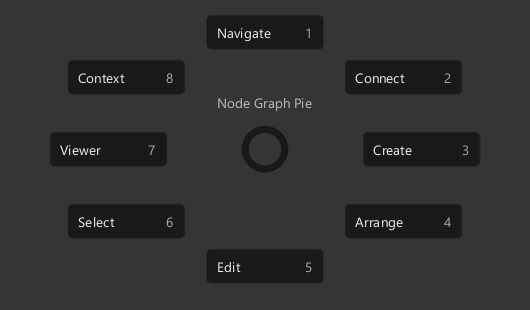
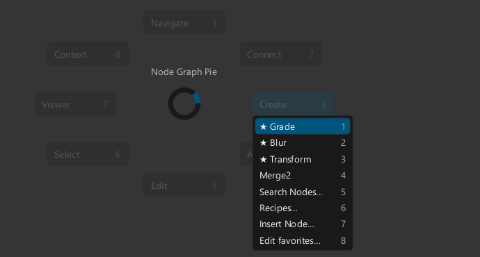
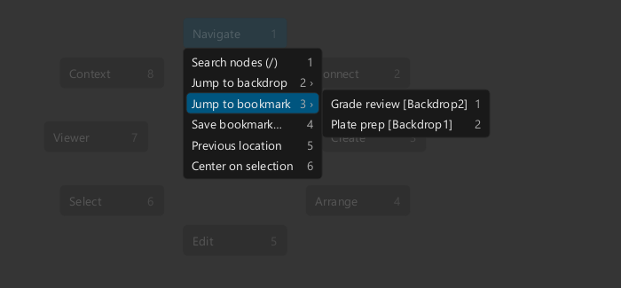
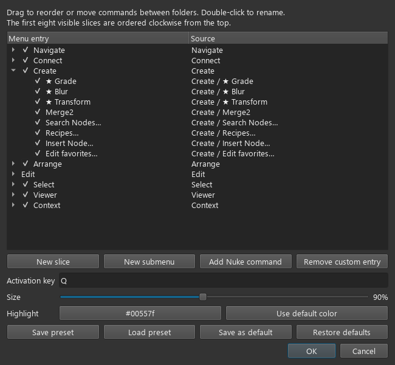

# Node Graph Pie user guide

Use the pie to launch graph actions without moving to a toolbar. Start with the default layout on a scratch comp, then customize your most-used commands.

## Open and choose a command

1. Focus the Node Graph and tap **Q** to leave the pie open. You can also hold **Q** and release it over a command.
2. Move onto a slice. Its submenu opens below it and the other cards dim. Nested flyouts appear to the right.
3. Click a command or release the activation key over its row. With keyboard input, first press the slice number, then the row number. A numbered flyout uses its own displayed numbers.
4. Move away from the cards and panels to dismiss the submenu. Press **Esc** to close the pie. Scroll within a flyout when it contains more than eight entries.

The screenshots in this guide show the shipped Qt widgets rendered with sample data. Menus can vary with your selection, graph, Viewer, and preset.

## Default menus

| Key | Slice | Commands and use |
| --- | --- | --- |
| 1 | Navigate | Search existing nodes with Nuke’s native **/** search. Jump to a backdrop or bookmarked node using a flyout. Save a named session location, return to a previous pie jump, or center on the selection. |
| 2 | Connect | Connect a vertically ordered pair into an unused input. Insert a Dot into a chosen outgoing wire, disconnect a chosen input, or preview and swap Merge A/B. |
| 3 | Create | Create a favorite or recent node, search node classes, open Recipes, insert a node into a chosen pipe, or edit favorites. |
| 4 | Arrange | Align left or top, distribute vertically, straighten a connected chain, fit a labeled backdrop, or auto-place selected nodes. Layout moves apply immediately and are undoable. |
| 5 | Edit | Duplicate selected nodes without replacing your clipboard, preview a batch rename, delete, enable or disable, copy, paste, or customize the pie. |
| 6 | Select | Add immediate inputs, trace upstream or downstream, find source Reads or output Writes, or select the nodes on paths between two anchors. |
| 7 | Viewer | Route two selected nodes to A/B using existing or free inputs. Display channels, reset gain and gamma, or toggle overlays when the active Viewer exposes those controls. |
| 8 | Context | Open floating Quick Properties, inspect file and range, reload compatible media, set Merge operations, center a Transform pivot, or enable and disable compatible nodes. The list depends on the selected classes. |

## Create nodes and recipes

Starred favorites appear first. Recent node classes appear below them without duplicates. The submenu has room for four direct node shortcuts, and more favorites and recents are available through **Search Nodes**. The search list uses the host’s node-class catalog when exposed and accepts a valid class name.

Creating from one compatible selected node adds a downstream branch and preserves existing wires. Without a single compatible source, the result is loose near the graph center. For insertion, select the upstream node, use **Insert Node…**, then choose the exact destination and input.

**Create → Recipes…** includes **Unpremult → Grade → Premult** and **Dot → Grade**. To save a personal recipe, select a single linear chain connected through input zero, choose **Save Selection as Recipe…**, and give it a name. The recipe retains relative positions and supported knob settings. File and proxy paths are omitted, and saved recipes are reused from local preferences.

**Insert Recipe into Pipe…** inserts a recipe into a chosen outgoing connection. **Remove Saved Recipe…** removes a personal recipe after confirmation. It leaves the built-in recipes and previously created nodes intact.

## Navigate and select

Use the **Bookmark** checkbox on a node’s **Node** tab to include it in **Jump to Bookmark**. The pie rebuilds the list on open. **Jump to Backdrop** lists backdrops in the current graph and stars those marked as bookmarks. **Save Bookmark…** adds a named coordinate for the current session. Jumps center the target while retaining the current zoom. **Previous Location** steps back through pie navigation positions.

For dependency tracing, select one or more nodes and choose the direction or endpoint filter in **Select**. **Between Two Anchors** needs exactly two selected nodes with a directed path between them. A missing path or endpoint leaves your selection intact.

## Work with Viewer and node properties

Select two image nodes and use **Viewer → Compare Selected A/B…**. The confirmation shows which node will be A and which will be B. The command reuses connected slots or fills free slots and activates both sources. Use the Viewer’s wipe controls to inspect the comparison.

**Context → Quick Properties…** opens native, draggable floating Properties windows for the selected nodes. The controls are the standard controls for each node class. Press **Esc** while a tracked panel has focus to dismiss the temporary windows.

## Customize and save presets

1. Open **Edit → Customize Pie…** or **Studio → Customize Pie**.
2. Drag slices to change their clockwise order, starting at the top. Drag commands or folders to reorder them or move them between menus. Double-click a label to rename it. Use the checkbox to show or hide an entry.
3. Use **New Slice** or **New Submenu** to create a container. For built-in commands, choose **Add Nuke Command**, expand Nuke’s main menu or Nodes toolbar, and select a command. A slice must contain a visible command to appear.
4. Capture one key or chord in **Activation Key**, adjust the **Size** slider, and pick a **Highlight** color. **Use Default Color** restores `#00557f`.
5. Click **OK** to activate the layout. Keep at most eight visible main slices. Long command lists use a **More** entry, and deeper levels use native Qt menus.

**Save Preset** stores the layout, key, size, and highlight under a reusable name. **Load Preset** brings those settings into the editor. **Save as Default** sets the preset that **Restore Defaults** will load. If you haven’t saved a default, **Restore Defaults** loads the original layout. The editor entry remains reachable through Studio even after shortcut changes.

## Troubleshooting

| Symptom | Check |
| --- | --- |
| Q runs another Nuke action | Confirm **Studio → Pie Menu** exists. Verify the plugin path, restart Nuke, then focus the Node Graph. If you changed the key, open the editor from Studio to check the binding. |
| A command is missing | Check slice visibility and preset settings. Context and Viewer commands also depend on supported nodes and controls. |
| A recipe cannot be saved | Select a connected chain with one entry and no internal splits. Internal links must use input zero. |
| A pipe insertion is rejected | Confirm the source is still connected to the chosen input and the created node or chain accepts the connection. |
| A native command is unavailable | The underlying Nuke menu item may have moved or may depend on a plug-in. Remove and re-add it from the command browser. |
| The pie will not load | Check Nuke’s startup output for `[Node Graph Pie]` and the traceback. Include the Nuke version, OS, graph context, and reproduction steps when reporting a problem. |

## Verification and compatibility

The bundle is a Nuke plug-in rather than a PyPI module. Its Python files compile and the screenshots exercise the shipped Qt rendering and editor. The screenshots do not exercise Nuke’s graph engine. Validate startup, wiring and Undo, Viewer controls, and floating panels in your target Nuke version before relying on the plug-in in production.
